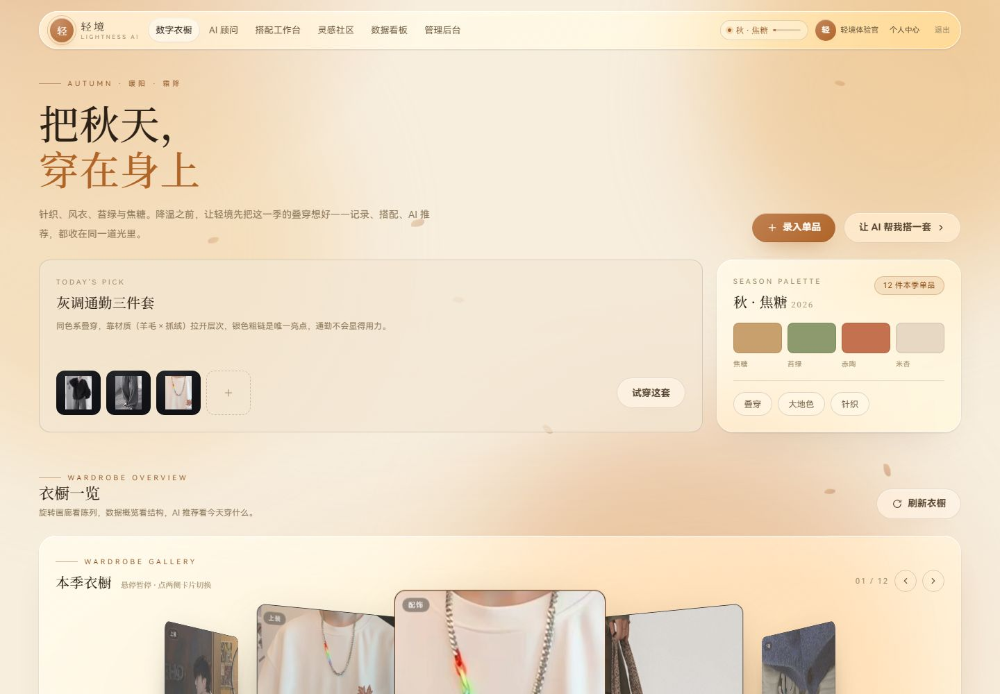
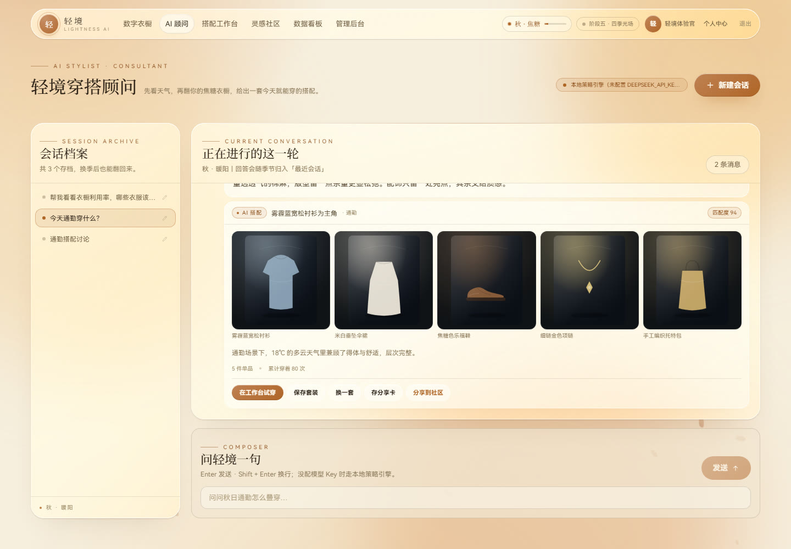
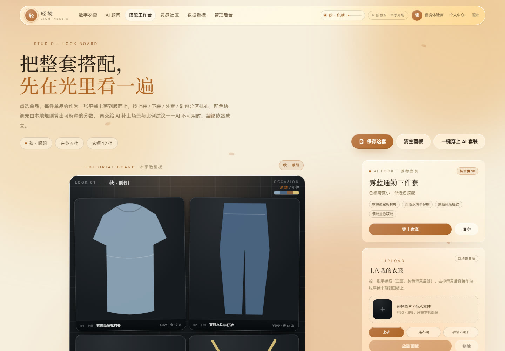
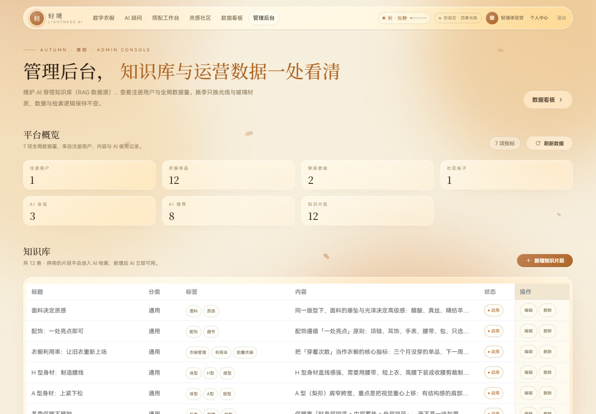
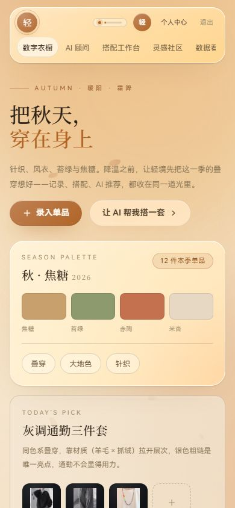

<div align="center">

# 轻境 · Lightness AI

**四季衣橱 × AI 穿搭顾问 × 2D 造型板**

录入单品、按季节整理衣橱，让 AI 结合真实衣橱数据、实时天气与穿搭知识给出「今天就能穿」的整套搭配，
并把每一次穿着沉淀成可量化的衣橱数据。


[主要功能](#-主要功能) · [界面预览](#-界面预览) · [快速开始](#-快速开始) · [接口](#-主要接口) · [设计文档](docs/design.md) · [参考项目](docs/references.md)

</div>



## 📌 项目简介

| | |
| --- | --- |
| **解决的问题** | 衣橱塞满却总觉得没衣服穿、单次穿着成本无法量化、每天出门前花时间纠结搭配 |
| **产品形态** | 一个 Web 应用：数字衣橱 + AI 穿搭顾问 + 2D 造型板 + 灵感社区 + 数据看板 |
| **技术形态** | Vue 3 单页应用 + Spring Boot 单体分层服务 + MySQL；AI 侧走 OpenAI 兼容接口 + Function Calling |
| **差异点** | 不靠模板文案：AI 真的去查天气、翻你的衣橱、再给出结构化搭配，且推荐曝光/采纳可度量 |

> **平台说明**：本项目**只有 Web 端**，直接在 PC 或手机浏览器访问，没有独立的 iOS / Android 客户端，也没有小程序。
> 页面做了响应式适配，390px 宽度下可正常使用（见 [界面预览](#-界面预览) 最后一张图）。

## ✨ 主要功能

**衣橱管理**

| 功能 | 说明 |
| --- | --- |
| 单品录入与管理 | 名称、品类、子类、颜色（取色器）、材质、品牌、价格、购入日期、适穿季节、风格标签、图片 |
| 图片上传 | 本地图片经后端保存并回填地址（≤5MB，PNG/JPG/WEBP/GIF），也可直接填图片链接 |
| 检索与筛选 | 关键词搜索（防抖）、品类筛选、仅看收藏、四种排序、分页 |
| 穿着记录 | 一键记「今天穿了」，累计穿着次数与最近穿着日期；落库 `wear_log` 供统计使用 |
| 收藏与逻辑删除 | 收藏切换；删除为逻辑删除，不物理破坏数据 |

**AI 穿搭**

| 功能 | 说明 |
| --- | --- |
| 流式对话 | SSE 逐字输出，支持停止生成、失败重试、会话重命名 |
| 工具调用 | 模型自主决定是否查天气、翻衣橱、看统计、出推荐，最多 3 轮工具循环 |
| 结构化推荐 | 推荐以工具调用返回，前端拿到的是合法单品 ID 数组 + 契合度 + 理由，直接渲染成卡片 |
| 轻量 RAG | 12 条穿搭知识片段（面料、配饰、身形、换季…）存表，中文二元组 + 标签检索，管理端改完即时热刷新 |
| 推荐采纳率 | 曝光（SHOWN）与采纳（TRY_ON / SAVE）分开记录，看板可见采纳率 |
| 本地降级 | 没有 API Key 时走同一管线的本地策略引擎，功能完整可演示，不需要联网 |

**造型与数据**

| 功能 | 说明 |
| --- | --- |
| 2D 造型板 | 单品以平铺卡按品类落格（CSS Grid，零重叠），配色评分 0–100 由本地规则给出，可保存成套装 |
| AI → 造型板联动 | 推荐卡片、社区帖子的「试穿此搭」把单品 ID 写入路由，打开即还原整套 |
| 数据看板 | 10 项核心指标、品类分布、风格标签 Top 8、热门单品、分类价值、14 天趋势（ECharts） |
| 单次穿着成本 | CPW = 购入价 ÷ 穿着次数，给出平均值、最划算与最该处理的单品，以及前 8 名排行 |
| 穿着热力图 | 365 天 × 7 天网格，4 档浓度跟随当前季节配色，悬停查看当天穿着次数 |
| 个人中心 | 昵称、头像、性别、身高、体重、体型、风格偏好；这些字段会进入 AI 推荐上下文 |

**社区**

发帖（可关联套装）、信息流、点赞（唯一键去重）、评论、删除自己的内容、Canvas 分享卡片导出。

**视觉**

四季光场主题：春·新绿 / 夏·海盐 / 秋·杏黄 / 冬·夜雪四套色盘，30 秒自动轮播，
纯 CSS 液态玻璃材质与季节粒子背景，零图片依赖。详见 [docs/design.md](docs/design.md)。

## 🖼 界面预览

| AI 穿搭顾问（SSE 流式 + 推荐卡） | 2D 造型板（配色评分 + 保存套装） |
| --- | --- |
|  |  |

| 数据看板（CPW + 365 天热力图） | 管理后台（知识库维护） |
| --- | --- |
|  |  |

| 灵感社区 | 窄屏（390px，同一套 Web 页面） |
| --- | --- |
|  |  |

其余截图见 [`docs/screenshots/`](docs/screenshots/)：四季首页、个人中心、评论弹窗、Swagger 文档等。

## 🚀 快速开始

### 环境要求

| 依赖 | 版本 | 说明 |
| --- | --- | --- |
| JDK | 17+ | 项目按 Java 17 编译；JDK 21/25 亦可运行 |
| Maven | 3.8+ | 仓库自带 `mvnw` / `mvnw.cmd`，无需另装 |
| Node.js | 18+ | 前端构建 |
| Yarn | 1.22 | 仓库含 `yarn.lock`，请用 yarn 安装依赖 |
| MySQL | 8.0 | 库名 `chuaizhibeidatabase`，字符集 `utf8mb4` |

### 1. 初始化数据库

```bash
mysql -uroot -p -e "CREATE DATABASE IF NOT EXISTS chuaizhibeidatabase DEFAULT CHARSET utf8mb4;"
mysql -uroot -p chuaizhibeidatabase < newbackend/db/schema.sql
mysql -uroot -p chuaizhibeidatabase < newbackend/db/seed.sql
```

`schema.sql` 建 11 张表；`seed.sql` 写入演示账号、12 件单品、2 套套装、12 条穿搭知识、
1 条社区帖子与一年份穿着记录（可重复执行）。

### 2. 启动后端（8080）

```bash
cd newbackend
# 可选：接入真实大模型；不配置则自动使用本地策略引擎
export DEEPSEEK_API_KEY=sk-xxxx     # Windows: set DEEPSEEK_API_KEY=sk-xxxx

./mvnw -DskipTests package          # Windows: mvnw.cmd -DskipTests package
java -jar target/newbackend-0.0.1-SNAPSHOT.jar
```

健康检查：`GET http://localhost:8080/api/health` → `{"status":"UP","database":"UP"}`
接口文档：<http://localhost:8080/swagger-ui.html>

### 3. 启动前端（5173）

```bash
cd frontend
yarn install
yarn dev          # /api 已代理到 127.0.0.1:8080
```

打开 <http://localhost:5173>，用演示账号登录：**`demo` / `123456`**。

其他脚本：

```bash
yarn build        # 类型检查 + 生产构建（dist 约 1.45 MB）
yarn preview      # 预览生产构建
yarn type-check   # 仅类型检查
```

## ⚙️ 配置

后端配置文件：`newbackend/src/main/resources/application.properties`

| 配置项 / 环境变量 | 默认值 | 说明 |
| --- | --- | --- |
| `DEEPSEEK_API_KEY` | 空 | 配置后切换到真实模型；留空走本地策略引擎 |
| `DEEPSEEK_BASE_URL` | `https://api.deepseek.com` | 任意 OpenAI 兼容服务（通义千问兼容模式、Kimi、本地 vLLM 等） |
| `DEEPSEEK_MODEL` | `deepseek-chat` | 模型名 |
| `QINGJING_JWT_SECRET` | 开发默认值 | 生产部署请务必替换 |
| `spring.datasource.*` | `localhost:3306` / root / 123456 | 本地开发默认值，按需修改 |

> 仓库内不含任何真实密钥；上述敏感项均通过环境变量注入。

## 🏗 技术栈

| 层 | 选型 |
| --- | --- |
| 前端框架 | Vue 3.5（`<script setup>`）+ TypeScript strict + Pinia + Vue Router |
| 构建与样式 | Vite 6 + Tailwind CSS 4 + 自定义 CSS 设计令牌（四季色盘 / 间距圆角标度） |
| UI 与图表 | Element Plus 2.14（自动按需引入）+ ECharts 6（按需注册图表类型） |
| 通信 | Axios；流式对话用 `fetch + ReadableStream` 自行解析 SSE |
| 后端 | Spring Boot 4.1.2 + Java 17 + MyBatis-Plus 3.5（boot4 starter） |
| 数据库 | MySQL 8（utf8mb4 / InnoDB，11 张表） |
| AI 接入 | JDK 自带 `HttpClient` 直连 OpenAI 兼容 SSE，不引入第三方大模型 SDK |
| 鉴权 | JWT（jjwt 0.12）+ BCrypt（`spring-security-crypto`，未启用整套 Spring Security） |
| 接口文档 | springdoc-openapi 3.2（Swagger UI） |

## 🧠 AI 是怎么工作的

```
用户提问
  │
  ├─ RAG：中文二元组 + 标签命中 → Top-3 穿搭知识片段
  ├─ 上下文：人设规则 + 用户档案（身高/体重/体型/风格）+ 衣橱概况
  ▼
LLM（OpenAI 兼容，stream=true）
  │  delta 文本  → SSE「delta」事件（前端打字机）
  │  tool_calls → 执行工具 → 结果回填 → 继续生成（最多 3 轮）
  │
  ├─ get_weather(city)      实时天气（Open-Meteo），失败回退季节气候值
  ├─ search_wardrobe(...)   真实单品，按穿着次数升序（优先唤醒久未穿的单品）
  ├─ wardrobe_stats()       件数 / 收藏 / 未穿 / 总值 / 品类分布
  └─ recommend_outfit(...)  结构化推荐：单品 ID + 契合度 + 理由
  ▼
SSE「recommendation」→ 前端推荐卡片 → 采纳时记录 TRY_ON / SAVE → 看板采纳率
```

**无 Key 也能演示**：`OfflineReplyClient` 是本地策略引擎，但走**同一条 Agent 管线**——
同样先调天气与衣橱工具，再流式输出中文文案并给出结构化推荐。两条通道可一键切换，
方便对比「真实大模型 vs 规则引擎」的输出差异。

## 📡 主要接口

统一响应 `{"code":0,"msg":"ok","data":...}`；错误码 `40000` 参数、`40400` 不存在、`50000` 服务异常。
除 `/api/auth/login`、`/api/auth/register`、`/api/health` 外，其余接口需带 `Authorization: Bearer <token>`。

<details>
<summary><b>衣橱 / 套装 / 看板 / 社区（点击展开）</b></summary>

| 方法 | 路径 | 说明 |
| --- | --- | --- |
| GET | `/api/health` | 服务与数据库健康检查 |
| GET | `/api/meta/categories` | 分类字典 |
| GET | `/api/clothing` | 分页检索：`category`、`keyword`、`favorite`、`season`、`sort`、`page`、`size` |
| GET | `/api/clothing/stats` | 衣橱统计 |
| POST / PUT / DELETE | `/api/clothing[/{id}]` | 单品增删改（逻辑删除） |
| PATCH | `/api/clothing/{id}/favorite` | 收藏切换 |
| POST | `/api/clothing/{id}/wear` | 记一次穿着（同时写入 `wear_log`） |
| GET | `/api/outfit` | 套装列表 |
| POST | `/api/outfit` | 保存套装（校验只能引用自己的单品） |
| DELETE | `/api/outfit/{id}` | 删除自己的套装 |
| GET | `/api/dashboard` | 看板：概览 / 品类 / 标签 / 热门 / 价值 / 趋势 / CPW / 热力图 |
| POST | `/api/recommendations/{id}/adopt` | 采纳推荐（TRY_ON / SAVE） |
| GET | `/api/community/posts` | 社区信息流（作者 / 单品 / 点赞状态） |
| POST | `/api/community/posts` | 发布分享（可关联套装） |
| POST | `/api/community/posts/{id}/like` | 点赞 / 取消点赞 |
| DELETE | `/api/community/posts/{id}` | 删除自己的帖子 |
| GET | `/api/community/posts/{id}/comments` | 评论列表 |
| POST | `/api/community/posts/{id}/comments` | 发表评论（同步 `commentCount`） |
| DELETE | `/api/community/comments/{id}` | 删除自己的评论 |
| POST | `/api/upload` | 图片上传（multipart，≤5MB） |
| GET | `/api/knowledge` | 启用的知识库片段（用户端只读） |

</details>

<details>
<summary><b>AI 对话与鉴权（点击展开）</b></summary>

| 方法 | 路径 | 说明 |
| --- | --- | --- |
| POST | `/api/auth/login` | 登录，返回 JWT + 用户资料 |
| POST | `/api/auth/register` | 注册并直接登录 |
| GET | `/api/auth/me` | 当前用户资料 |
| PUT | `/api/auth/profile` | 更新个人资料（昵称 / 身高 / 体重 / 体型 / 风格偏好） |
| POST | `/api/ai/chat/stream` | 流式对话（SSE） |
| GET | `/api/ai/status` | 当前通道、工具清单、知识库规模 |
| GET | `/api/ai/sessions` | 最近会话 |
| GET | `/api/ai/sessions/{id}/messages` | 会话历史（含推荐 JSON 回放） |
| PATCH | `/api/ai/sessions/{id}` | 重命名会话 |
| DELETE | `/api/ai/sessions/{id}` | 删除会话 |

</details>

<details>
<summary><b>管理端（演示用，未做严格 RBAC）</b></summary>

| 方法 | 路径 | 说明 |
| --- | --- | --- |
| GET | `/api/admin/overview` | 全局数据概览 |
| GET | `/api/admin/users` | 注册用户列表 |
| GET / POST | `/api/admin/knowledge` | 知识库片段列表 / 新增 |
| PUT / DELETE | `/api/admin/knowledge/{id}` | 修改 / 删除知识片段（写后 RAG 索引热刷新） |

</details>

### SSE 事件协议

`POST /api/ai/chat/stream`，`Content-Type: text/event-stream`

| 事件 | 负载 | 用途 |
| --- | --- | --- |
| `meta` | `{sessionId, provider, tools, knowledgeChunks}` | 会话建立、当前通道信息 |
| `status` | `{phase, text}` | 思考过程：理解需求 / 查天气 / 翻衣橱 |
| `delta` | `{text}` | 正文增量，前端逐字追加 |
| `recommendation` | `{recommendation:{name,occasion,score,reason,items[]}}` | 结构化搭配，驱动推荐卡片 |
| `done` | `{sessionId, messageId, tools}` | 结束，附落库消息 ID 与工具轨迹 |
| `error` | `{message}` | 友好错误提示 |

客户端中途断开时，已生成内容仍会落库并标注「本次生成被中断」，历史会话不会只剩半句问话。

## 📁 项目结构

```
qingjing/
├─ newbackend/                        # 后端（Spring Boot 4.1.2 / Java 17）
│  ├─ src/main/java/com/czit/
│  │  ├─ ai/                          # Agent 编排、模型通道、RAG
│  │  │  ├─ LlmClient / OpenAiCompatibleClient / OfflineReplyClient
│  │  │  ├─ OutfitAgent               # 提示词拼装 + 工具循环
│  │  │  ├─ OutfitKnowledge           # 轻量 RAG（中文二元组检索）
│  │  │  └─ tool/                     # 四个工具 + 注册表
│  │  ├─ auth/                        # JwtService / JwtAuthFilter
│  │  ├─ controller/                  # 各业务 HTTP 入口
│  │  ├─ service/ + impl/             # 业务接口与实现（分层）
│  │  ├─ config/                      # MyBatis-Plus / Jackson / OpenAPI / SSE 线程池
│  │  ├─ common/                      # Result 统一响应体、异常、工具
│  │  └─ dto / entity / mapper / vo/
│  ├─ src/main/resources/
│  │  ├─ application.properties
│  │  └─ ai/outfit-knowledge.json     # 12 条穿搭知识（首次启动写入表）
│  └─ db/                             # schema.sql（11 表）+ seed.sql（演示数据）
├─ frontend/                          # 前端（Vue 3.5 / Vite 6 / TS strict）
│  ├─ src/api/                        # http / ai（SSE）/ auth / community / dashboard / admin / outfit / upload
│  ├─ src/stores/                     # wardrobe / assistant / auth / theme（四季光场）
│  ├─ src/theme/seasons.ts            # 四季元数据：文案、色卡、节气、明暗
│  ├─ src/components/                 # 衣橱组件、RotatingGallery、SeasonBackdrop、styling/、ai/、community/
│  ├─ src/views/                      # Wardrobe / Assistant / Mirror / Community / Stats / Profile / Admin
│  ├─ src/utils/                      # shareCard（Canvas 分享卡）/ palette（配色评分）/ image
│  ├─ src/style.css                   # 设计令牌 + 液态玻璃 + 布局标度
│  └─ public/                         # 12 张演示单品插画（clothing/ 原图、catalog/ 裁边版）
├─ docs/
│  ├─ design.md                       # 四季光场 · 液态玻璃设计系统
│  ├─ references.md                   # 同赛道项目调研与取舍
│  └─ screenshots/                    # 页面实拍
└─ README.md
```

## 🎨 视觉设计

界面不是一套固定主题，而是**四束光**：

| 季节 | 光线 | 主色 | 明暗 |
| --- | --- | --- | --- |
| 春 | 晨光 | 柳芽绿 `#5f7f58` | 浅色纸感 |
| 夏 | 正午 | 海盐蓝 `#2f7c88` | 浅色纸感 |
| 秋 | 暖阳 | 焦糖橙 `#b06526` | 浅色纸感 |
| 冬 | 夜雪 | 冰蓝 `#a9c9e2` | 深色夜色 |

- 换季只改 `<html data-season>` 与 `data-scheme` 两个属性，色盘、玻璃材质、图表配色、Element Plus 深浅色一起切换
- 液态玻璃用 `backdrop-filter` + `mask-composite` 双层折射边框 + 内高光实现，纯 CSS、零图片
- 季节背景是三层缓慢漂移的色晕 + 季节粒子（花瓣 / 光尘 / 落叶 / 雪）+ 颗粒，`prefers-reduced-motion` 下全部停止
- 间距与圆角使用固定标度（`--space-1..8`、`--radius-xs..lg`），页面按「拆块 → 组间留白 → 同级错落 → 操作对比突出」组织

实现细节与改动方法见 [docs/design.md](docs/design.md)。

## 🗺 后续计划

- [ ] **灵感复刻**：上传一张参考搭配图，视觉模型拆出单品（品类/颜色/材质/风格），在自有衣橱里匹配并给出「可复刻度」
- [ ] **向量检索 RAG**：用中文 embedding 或 FashionCLIP 替换当前的关键词检索，提升跨表述召回
- [ ] **真实试穿**：本地部署 OOTDiffusion / FitDiT 一类模型，后端以 `/api/tryon` 转发，替代当前的 2D 造型板预览
- [ ] **分享卡片模板化**：多种版式 + 品牌水印，便于直接发社交平台
- [ ] **移动端体验打磨**：手势、底部导航、离线缓存（仍是同一个 Web 应用）

## ❓ 常见问题

<details>
<summary><b>启动后端报数据库连接失败？</b></summary>

确认 MySQL 已启动、库名是 `chuaizhibeidatabase`、账号密码与 `application.properties` 一致；
首次运行先执行 `newbackend/db/schema.sql` 与 `seed.sql`。
</details>

<details>
<summary><b>没有大模型 API Key 能跑吗？</b></summary>

可以。留空 `DEEPSEEK_API_KEY` 时自动使用本地策略引擎，走同一条工具调用管线，
流式输出、结构化推荐、采纳率统计全部可用，只是文案由规则生成而非模型生成。
</details>

<details>
<summary><b>端口 8080 / 5173 被占用？</b></summary>

后端改 `application.properties` 里的 `server.port`；前端用 `yarn dev --port 5174`
（同时把 `vite.config.ts` 里 `/api` 代理目标改成实际后端端口）。
</details>

<details>
<summary><b>Safari 上玻璃效果偏弱？</b></summary>

液态玻璃依赖 `backdrop-filter`，Safari 需要 `-webkit-` 前缀（已加）。若系统开启「减少动态效果」，
季节自动轮播与粒子动画会自动停止，这是预期行为。
</details>

## 🤝 参与贡献

这是一个比赛项目，欢迎提 Issue 讨论思路或报 Bug。提交 Pull Request 前请：

1. 前端改动跑通 `yarn type-check` 与 `yarn build`
2. 后端改动跑通 `mvnw -DskipTests package`
3. 涉及 UI 的改动请附截图，并说明在深色季（冬）与浅色季（春/夏/秋）下的表现

## 📄 许可

本项目为参赛作品，暂未采用开源协议。如需引用代码或思路，请先联系作者。
后续若确定开源会在此补充 LICENSE。

## 🙏 参考与致谢

- 液态玻璃的 CSS 实现思路参考 [纯 CSS 高仿苹果液态玻璃](https://www.bilibili.com/video/BV1J8QSBqEpy)
- 首页旋转画廊参考 [服装类作品集交互](https://www.bilibili.com/video/BV1woVu6AE7L) 的 3D coverflow 效果
- 同赛道项目的对比与取舍见 [docs/references.md](docs/references.md)

---

<div align="center">

如果这个项目对你有帮助，欢迎点一个 ⭐

</div>