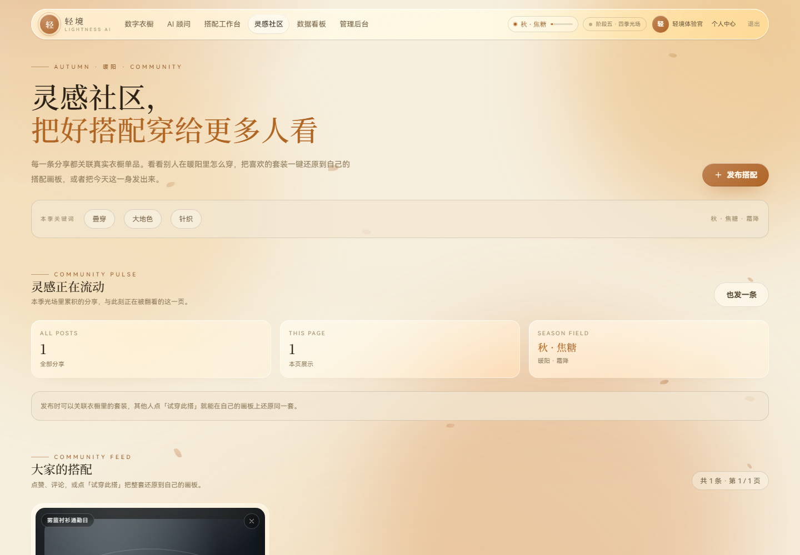
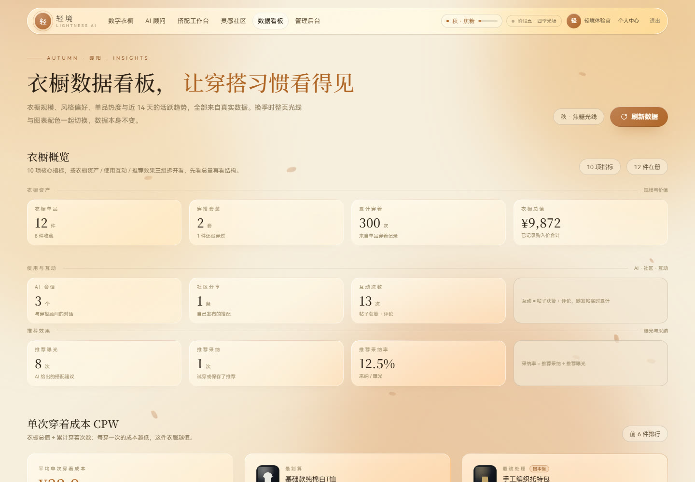
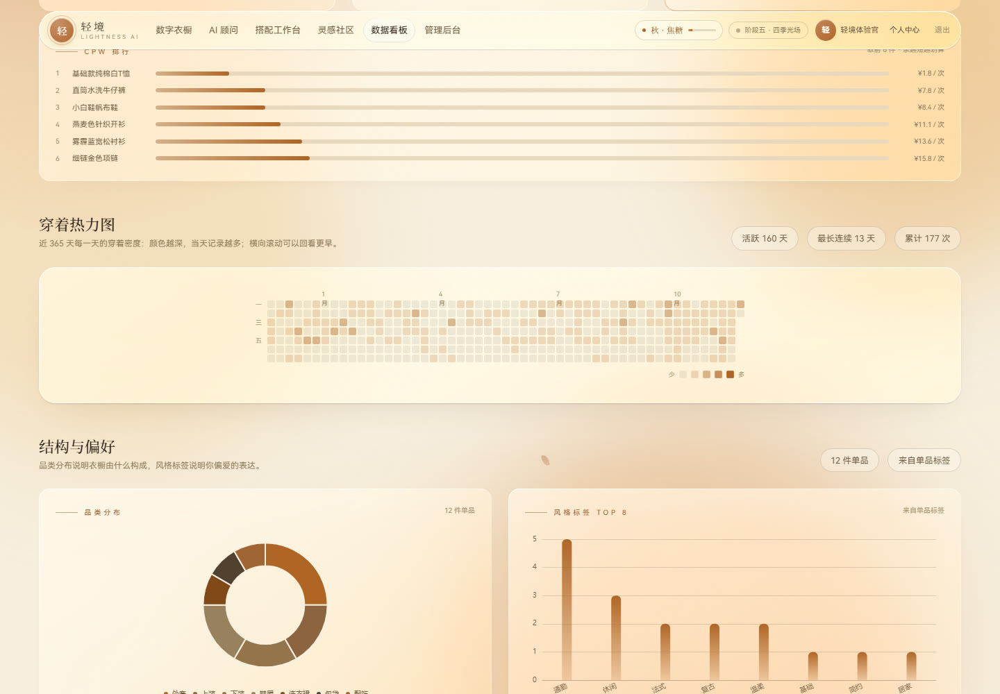
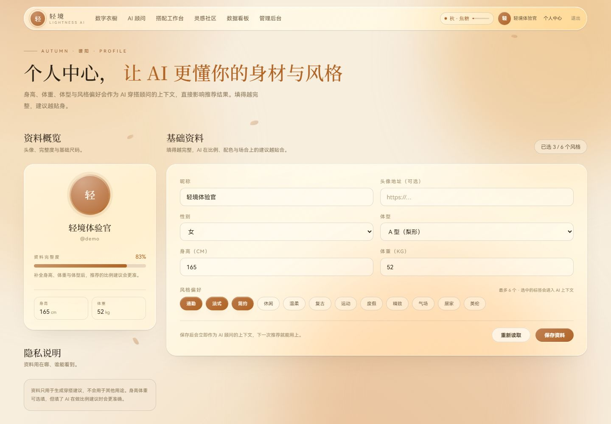
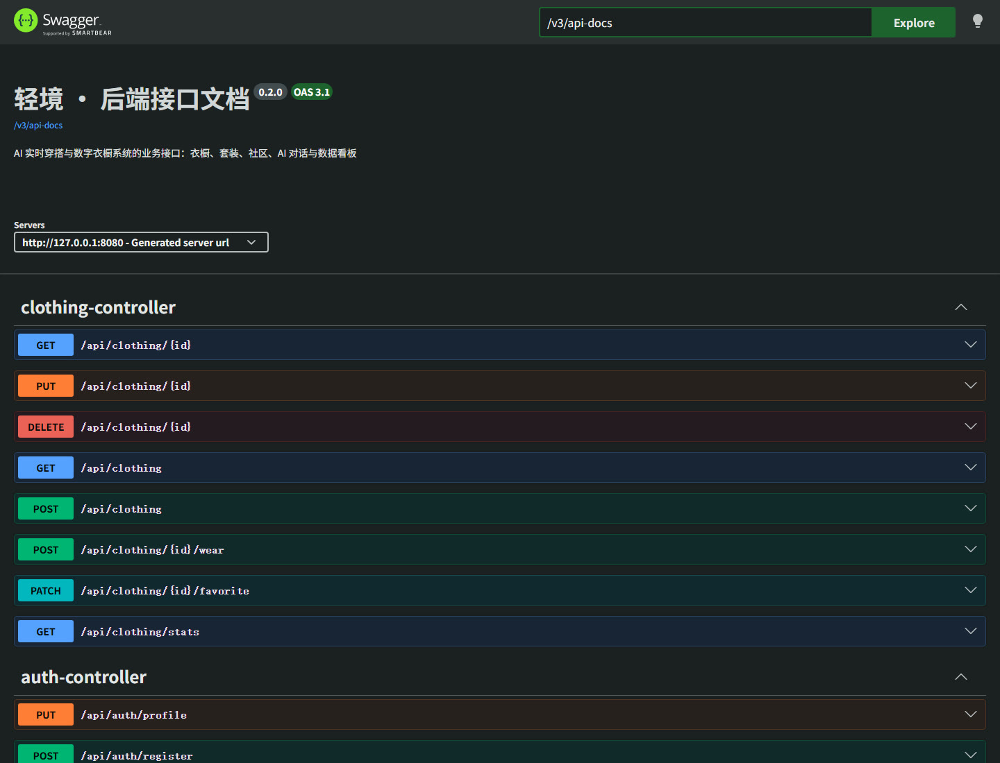

<div align="center">

# 轻境 · Lightness AI

**四季衣橱 × AI 穿搭顾问 × 2D 造型板**

把衣橱搬进浏览器：录入单品、按季节整理，让 AI 结合真实衣橱数据、实时天气与穿搭知识
给出「今天就能穿」的整套搭配，并把每一次穿着沉淀成可量化的衣橱数据。


[主要功能](#-主要功能) · [界面预览](#-界面预览) · [快速开始](#-快速开始) · [技术栈](#-技术栈) · [主要接口](#-主要接口) · [设计文档](docs/design.md)

</div>


## 📌 项目简介

| | |
| --- | --- |
| **解决的问题** | 衣橱塞满却总觉得没衣服穿、每天早上纠结穿什么、买错衣服无法复盘「值不值」 |
| **产品形态** | 一个 Web 应用：数字衣橱 + 搭配工作台 + AI 穿搭顾问 + 灵感社区 + 数据看板 + 个人中心 + 管理后台 |
| **技术形态** | Vue 3 单页应用 + Spring Boot 单体分层服务 + MySQL；AI 侧走 OpenAI 兼容接口 + Function Calling |
| **核心差异** | AI 推荐的是你衣橱里**真实存在**的单品，且推荐效果（曝光 / 采纳 / 采纳率）全程可度量 |

> **平台说明**：本项目为 Web 应用，PC 与手机浏览器均可访问，没有独立的 iOS / Android 客户端或小程序。
> 页面做了响应式适配，390px 宽度下可正常使用。

## ⚡ 加载体验与技术取舍

| 方向 | 主要改动 | 结果 |
| --- | --- | --- |
| **加载体验** | 下线 Three.js + MediaPipe 端侧姿态识别（wasm 运行时与姿态模型合计约 **33.5 MB** 静态资源），改用纯 CSS / DOM 的 **2D 造型板**；路由全部懒加载；ECharts 独立分包；演示图片统一压缩为 JPEG | 构建产物 **34.8 MB → 3.2 MB**；首屏主包 gzip **≈ 69 KB**；看板 ECharts chunk gzip 191 KB，**仅进入看板时下载**；工作台路由 chunk 27 KB |
| **内容具体** | 12 件实拍单品（名称 / 品牌 / 价格与照片一致）、8 套带封面的套装、6 条社区真实分享、单次穿着成本、365 天穿着热力图、推荐采纳率闭环 | 见下方「主要功能」与截图 |

**为什么是 2D 造型板**：3D 试衣需要为一次预览加载 MB 级运行时与模型，代价与收益不成比例；
造型板用 CSS Grid 把单品摊成平铺卡，配合本地可解释的配色评分，交互更直接、信息密度更高，
且不依赖摄像头与 GPU。**真·虚拟试穿**（扩散模型）已列入 [后续计划](#-后续计划)，
计划以本地推理服务 + `/api/tryon` 转发提供，模型资源不进前端首屏。

**后续还会继续优化加载**：图片按需加载与更细粒度分包、静态资源强缓存与压缩传输、
首屏关键路径收缩。当前基线数据如上表，可作为后续对比的参照。

## ✨ 主要功能

**衣橱（`/`）**

| 功能 | 说明 |
| --- | --- |
| 单品建档 | 名称、品类（7 类）、子类、颜色名 + 色值、材质、品牌、价格、购入日期、适穿季节、风格标签、图片 |
| 检索筛选 | 关键词（防抖）、品类筛选、仅看收藏、四种排序、分页 |
| 穿着记录 | 一键「今天穿了」→ 穿着次数 +1、最近穿着日期更新，并写入 `wear_log` 流水 |
| 图片上传 | 本地图片上传后端（≤5MB，PNG/JPG/WEBP/GIF），按月份归档、UUID 命名 |
| 旋转衣橱画廊 | 纯 CSS 3D coverflow，自动轮播、悬停暂停、点两侧卡片切换 |

**搭配工作台（`/mirror`）**

| 功能 | 说明 |
| --- | --- |
| 2D 造型板 | 单品渲染为「平铺卡」，按上装 / 下装 / 外套 / 鞋履 / 包袋 / 配饰分区落格，网格布局零重叠 |
| 版面标注 | `LOOK 01` 刊头、场合与件数、Pantone 式配色条、衬线体搭配 caption |
| 配色评分 | 本地规则算色相跨度 / 明度跨度 / 品类完整度，输出 0–100 分 + 一句可读结论 |
| 保存套装 | 存进「我的套装」，后端校验只能引用本人衣橱的单品 |
| AI 联动 | 推荐卡或社区帖子的「试穿此搭」把单品 ID 写进路由，打开即还原整套 |
| 上传自己的单品 | 上传后作为一张平铺卡落到画板上 |

**AI 穿搭顾问（`/assistant`）**

| 功能 | 说明 |
| --- | --- |
| 流式对话 | SSE 逐字输出，支持停止生成、失败重试、会话重命名、历史回放 |
| 工具调用 | 模型自行决定调天气 / 翻衣橱 / 看统计 / 出推荐，最多 3 轮工具循环 |
| 结构化推荐 | 推荐以工具调用返回：真实单品 ID + 契合度 + 理由，前端直接渲染成卡片 |
| 轻量 RAG | 12 条穿搭知识存表，中文二元组 + 标签检索，管理端改完即时热刷新 |
| 无 Key 降级 | 未配置 API Key 时走本地策略引擎，链路与真实模型一致，功能完整可演示 |

**灵感社区（`/community`）**

发帖（可关联套装）、信息流、点赞（唯一键去重）、评论、一键试穿此搭、Canvas 分享卡片。

**数据看板（`/stats`）**

| 功能 | 说明 |
| --- | --- |
| 10 项核心指标 | 衣橱资产 / 使用互动 / 推荐效果三组拆分展示 |
| 五类图表 | 品类分布、风格标签 Top 8、热门单品、分类价值、14 天活跃趋势（ECharts） |
| 单次穿着成本 | 平均值、最划算单品、最该处理单品，以及前 8 名条形排行 |
| 365 天热力图 | 53 列 × 7 行，浓度跟随季节配色，悬停看当天次数 |

**个人中心（`/profile`）与 管理后台（`/admin`）**

个人资料（昵称、头像、身高体重、体型、风格偏好）会直接进入 AI 推荐上下文；
管理后台用于维护 AI 知识库与查看平台数据，**仅管理员账号可见**。

**视觉系统**

四季光场：春·新绿 / 夏·海盐 / 秋·杏黄 / 冬·夜雪四套色盘，30 秒自动轮播；
纯 CSS 液态玻璃材质与季节粒子背景，零图片依赖。页面区块在滚动时淡入显现。

## 🖼 界面预览

| 数字衣橱 | 搭配工作台（平铺造型板） |
| --- | --- |
|  |  |

| AI 穿搭顾问（流式 + 结构化推荐） | 灵感社区 |
| --- | --- |
|  |  |

| 数据看板 | 管理后台 |
| --- | --- |
|  |  |

| 单次穿着成本 + 365 天热力图 | 个人中心 |
| --- | --- |
|  |  |

| 窄屏（390px） | 接口文档（Swagger UI） |
| --- | --- |
|  |  |

更多截图见 [`docs/screenshots/`](docs/screenshots/)。

## 🚀 快速开始

### 环境要求

| 依赖 | 版本 | 说明 |
| --- | --- | --- |
| JDK | 17+ | 项目按 Java 17 编译，JDK 21 / 25 亦可运行 |
| Maven | 3.8+ | 仓库自带 `mvnw` / `mvnw.cmd` |
| Node.js | 18+ | 前端构建 |
| Yarn | 1.22 | 仓库含 `yarn.lock`，请用 yarn |
| MySQL | 8.0 | 库名 `chuaizhibeidatabase`，字符集 `utf8mb4` |

### 1. 初始化数据库

```bash
mysql -uroot -p -e "CREATE DATABASE IF NOT EXISTS chuaizhibeidatabase DEFAULT CHARSET utf8mb4;"
mysql -uroot -p chuaizhibeidatabase < newbackend/db/schema.sql
mysql -uroot -p chuaizhibeidatabase < newbackend/db/seed.sql
```

`schema.sql` 建 11 张表；`seed.sql` 写入演示账号、12 件实拍单品、8 套套装、12 条穿搭知识、
6 条社区分享与一年份穿着记录（可重复执行）。

> **演示图片说明**：`frontend/public/items` 与 `public/looks` 下的照片来自公开穿搭内容，
> 仅用于界面演示，版权归原作者所有。替换成自己的素材只需改同名文件或在衣橱里上传单品图。

### 2. 启动后端（8080）

```bash
cd newbackend
# 可选：接入真实大模型；不配置则自动使用本地策略引擎
export DEEPSEEK_API_KEY=sk-xxxx      # Windows: set DEEPSEEK_API_KEY=sk-xxxx

./mvnw -DskipTests package           # Windows: mvnw.cmd -DskipTests package
java -jar target/newbackend-0.0.1-SNAPSHOT.jar
```

- 健康检查：`GET /api/health`
- 接口文档：`http://localhost:8080/swagger-ui.html`

### 3. 启动前端（5173）

```bash
cd frontend
yarn install
yarn dev           # /api 与 /uploads 已代理到 127.0.0.1:8080
```

打开 <http://localhost:5173>。

### 4. 演示账号

| 账号 | 密码 | 角色 | 说明 |
| --- | --- | --- | --- |
| `demo` | `123456` | **管理员** | 可看到并进入「管理后台」 |
| `lin` / `xiaoyu` / `amu` | `123456` | 普通用户 | 看不到管理后台入口，直接访问 `/admin` 会被拦回首页 |

其他脚本：

```bash
yarn build        # 类型检查 + 生产构建（dist 约 3.2 MB）
yarn preview      # 预览生产构建
yarn type-check   # 仅类型检查
```

## ⚙️ 配置

后端配置位于 `newbackend/src/main/resources/application.properties`：

| 配置项 / 环境变量 | 默认值 | 说明 |
| --- | --- | --- |
| `DEEPSEEK_API_KEY` | 空 | 配置后切换到真实模型；留空走本地策略引擎 |
| `DEEPSEEK_BASE_URL` | `https://api.deepseek.com` | 任意 OpenAI 兼容服务 |
| `DEEPSEEK_MODEL` | `deepseek-chat` | 模型名 |
| `QINGJING_JWT_SECRET` | 开发默认值 | 生产部署请替换 |
| `spring.datasource.*` | localhost:3306 / root / 123456 | 本地开发默认值 |
| `spring.servlet.multipart.max-file-size` | `5MB` | 图片上传上限 |

> 仓库内不含任何真实密钥，敏感项均通过环境变量注入。

## 🏗 技术栈

| 层 | 选型 |
| --- | --- |
| 前端框架 | Vue 3.5（`<script setup>`）+ TypeScript strict + Pinia + Vue Router（全路由懒加载） |
| 构建与样式 | Vite 6 + Tailwind CSS 4 + 自定义 CSS 设计令牌（四季色盘 / 间距圆角标度） |
| UI 与图表 | Element Plus 2.14（自动按需引入）+ ECharts 6（按需注册，独立分包） |
| 交互增强 | 自研 `v-reveal` 滚动显现指令（原生 IntersectionObserver） |
| 通信 | Axios；流式对话 `fetch + ReadableStream` 自行解析 SSE |
| 后端 | Spring Boot 4.1.2 + Java 17 + MyBatis-Plus 3.5（boot4 starter） |
| 数据库 | MySQL 8（utf8mb4 / InnoDB，11 张表） |
| AI 接入 | JDK 自带 `HttpClient` 直连 OpenAI 兼容 SSE，不引第三方大模型 SDK |
| 并发 | SSE 生成任务跑在独立线程池，不占 Tomcat 线程 |
| 鉴权 | JWT（jjwt 0.12，含 `role` claim）+ BCrypt |
| 接口文档 | springdoc-openapi 3.2（Swagger UI） |

## 🧠 AI 是怎么工作的

```
用户提问
  │
  ├─ RAG：中文二元组 + 标签命中 → Top-3 穿搭知识片段
  ├─ 上下文：人设规则 + 用户档案（身高/体重/体型/风格）+ 衣橱概况
  ▼
LLM（OpenAI 兼容，stream=true）
  │  delta 文本  → SSE「delta」（前端打字机）
  │  tool_calls → 执行工具 → 结果回填 → 继续生成（最多 3 轮）
  │
  ├─ get_weather(city)      实时天气（Open-Meteo），失败回退季节气候值
  ├─ search_wardrobe(...)   真实单品，按穿着次数升序（优先唤醒久未穿的单品）
  ├─ wardrobe_stats()       件数 / 收藏 / 未穿 / 总值 / 品类分布
  └─ recommend_outfit(...)  结构化推荐：单品 ID + 契合度 + 理由
  ▼
SSE「recommendation」→ 前端推荐卡 → 采纳时记录 TRY_ON / SAVE → 看板采纳率
```

无 API Key 时由 `OfflineReplyClient` 接管，走**同一条**工具调用管线，
因此流式输出、结构化推荐与采纳统计在离线状态下依然可用。

## 🔐 角色与权限

| 能力 | 管理员 `ADMIN` | 普通用户 `USER` | 未登录 |
| --- | --- | --- | --- |
| 衣橱 / 工作台 / 社区 / 看板 / 个人中心 | ✅ | ✅ | 空态引导，写操作会提示先登录 |
| AI 对话 | ✅ | ✅ | 提示先登录 |
| 管理后台 `/admin` 与 `/api/admin/**` | ✅ | ❌（`40300 仅管理员可访问`） | ❌ |

角色随 JWT 的 `role` claim 下发，前端按角色渲染导航与路由守卫，后端在管理端接口入口再次校验。

## 📡 主要接口

统一响应 `{"code":0,"msg":"ok","data":...}`；错误码 `40000` 参数、`40300` 无权限、`40400` 不存在、`50000` 服务异常。
除登录 / 注册 / 健康检查外，其余接口需带 `Authorization: Bearer <token>`。

<details>
<summary><b>衣橱 / 套装 / 看板 / 社区 / 上传</b></summary>

| 方法 | 路径 | 说明 |
| --- | --- | --- |
| GET | `/api/health` | 服务与数据库健康检查 |
| GET | `/api/meta/categories` | 分类字典 |
| GET | `/api/clothing` | 分页检索：`category`、`keyword`、`favorite`、`season`、`sort`、`page`、`size` |
| GET | `/api/clothing/stats` | 衣橱统计 |
| POST / PUT / DELETE | `/api/clothing[/{id}]` | 单品增删改（逻辑删除） |
| PATCH | `/api/clothing/{id}/favorite` | 收藏切换 |
| POST | `/api/clothing/{id}/wear` | 记一次穿着（同时写 `wear_log`） |
| GET | `/api/outfit` | 套装列表 |
| POST | `/api/outfit` | 保存套装（校验只能引用本人单品） |
| DELETE | `/api/outfit/{id}` | 删除自己的套装 |
| GET | `/api/dashboard` | 看板：概览 / 品类 / 标签 / 热门 / 价值 / 趋势 / CPW / 热力图 |
| POST | `/api/recommendations/{id}/adopt` | 采纳推荐（TRY_ON / SAVE） |
| GET | `/api/community/posts` | 社区信息流 |
| POST | `/api/community/posts` | 发布分享（可关联套装） |
| POST | `/api/community/posts/{id}/like` | 点赞 / 取消 |
| DELETE | `/api/community/posts/{id}` | 删除自己的帖子 |
| GET / POST | `/api/community/posts/{id}/comments` | 评论列表 / 发表评论 |
| DELETE | `/api/community/comments/{id}` | 删除自己的评论 |
| POST | `/api/upload` | 图片上传（multipart，≤5MB） |
| GET | `/api/knowledge` | 启用的知识片段（用户端只读） |

</details>

<details>
<summary><b>AI 对话与鉴权</b></summary>

| 方法 | 路径 | 说明 |
| --- | --- | --- |
| POST | `/api/auth/login` | 登录，返回 JWT + 用户资料（含 `role`） |
| POST | `/api/auth/register` | 注册并登录（默认普通用户） |
| GET | `/api/auth/me` | 当前用户资料 |
| PUT | `/api/auth/profile` | 更新个人资料 |
| POST | `/api/ai/chat/stream` | 流式对话（SSE） |
| GET | `/api/ai/status` | 当前通道、工具清单、知识库规模 |
| GET | `/api/ai/sessions` | 最近会话 |
| GET | `/api/ai/sessions/{id}/messages` | 会话历史（含推荐 JSON 回放） |
| PATCH / DELETE | `/api/ai/sessions/{id}` | 重命名 / 删除会话 |

</details>

<details>
<summary><b>管理端（仅管理员）</b></summary>

| 方法 | 路径 | 说明 |
| --- | --- | --- |
| GET | `/api/admin/overview` | 全局数据概览 |
| GET | `/api/admin/users` | 注册用户列表（含角色） |
| GET / POST | `/api/admin/knowledge` | 知识库片段列表 / 新增 |
| PUT / DELETE | `/api/admin/knowledge/{id}` | 修改 / 删除知识片段（写后 RAG 索引热刷新） |

</details>

### SSE 事件协议

`POST /api/ai/chat/stream`，`Content-Type: text/event-stream`

| 事件 | 负载 | 用途 |
| --- | --- | --- |
| `meta` | `{sessionId, provider, tools, knowledgeChunks}` | 会话建立、通道信息 |
| `status` | `{phase, text}` | 思考过程：理解需求 / 查天气 / 翻衣橱 |
| `delta` | `{text}` | 正文增量，前端逐字追加 |
| `recommendation` | `{name,occasion,score,reason,items[]}` | 结构化搭配，驱动推荐卡 |
| `done` | `{sessionId, messageId, tools}` | 结束，附落库消息 ID 与工具轨迹 |
| `error` | `{message}` | 友好错误提示 |

客户端中途断开时，已生成内容仍会落库并标注「本次生成被中断」，历史会话不会只剩半句问话。

## 📁 项目结构

```
qingjing/
├─ newbackend/                        # 后端（Spring Boot 4.1.2 / Java 17）
│  ├─ src/main/java/com/czit/
│  │  ├─ ai/                          # Agent 编排、模型通道、RAG
│  │  ├─ auth/                        # JwtService / JwtAuthFilter / AuthController
│  │  ├─ controller/                  # 各业务 HTTP 入口
│  │  ├─ service/ + impl/             # 业务接口与实现分层
│  │  ├─ config/                      # MyBatis-Plus / Jackson / OpenAPI / SSE 线程池
│  │  ├─ common/                      # Result 统一响应体、异常、UserContext（含角色）
│  │  └─ dto / entity / mapper / vo/
│  ├─ src/main/resources/
│  │  ├─ application.properties
│  │  └─ ai/outfit-knowledge.json     # 12 条穿搭知识（首次启动写入表）
│  └─ db/                             # schema.sql（11 表）+ seed.sql（演示数据）
├─ frontend/                          # 前端（Vue 3.5 / Vite 6 / TS strict）
│  ├─ src/api/                        # http / ai（SSE）/ auth / community / dashboard / admin / outfit / upload
│  ├─ src/stores/                     # wardrobe / assistant / auth / community / theme
│  ├─ src/theme/seasons.ts            # 四季元数据：文案、色卡、节气、明暗
│  ├─ src/directives/reveal.ts        # v-reveal 滚动显现指令
│  ├─ src/components/                 # 衣橱组件、RotatingGallery、SeasonBackdrop、styling/、ai/、community/
│  ├─ src/views/                      # 七个页面
│  ├─ src/utils/                      # shareCard / palette / image
│  ├─ src/style.css                   # 设计令牌 + 液态玻璃 + 布局标度
│  └─ public/                         # clothing（插画）/ catalog（裁边）/ items（实拍单品）/ looks（整身穿搭）
├─ docs/
│  ├─ design.md                       # 四季光场 · 液态玻璃设计系统
│  ├─ references.md                   # 同赛道项目调研
│  └─ screenshots/                    # 页面实拍
└─ README.md
```

## 🎨 视觉设计

| 季节 | 光线 | 主色 | 明暗 |
| --- | --- | --- | --- |
| 春 | 晨光 | 柳芽绿 `#5f7f58` | 浅色纸感 |
| 夏 | 正午 | 海盐蓝 `#2f7c88` | 浅色纸感 |
| 秋 | 暖阳 | 焦糖橙 `#b06526` | 浅色纸感（杏黄底） |
| 冬 | 夜雪 | 冰蓝 `#a9c9e2` | 深色夜色 |

- 换季只改 `<html data-season>` 与 `data-scheme`，色盘、玻璃、图表配色、Element Plus 深浅色一起切换
- 液态玻璃由 `backdrop-filter` + `mask-composite` 双层折射边框 + 内高光构成，纯 CSS、零图片
- 季节背景是三层缓慢漂移的色晕 + 季节粒子（花瓣 / 光尘 / 落叶 / 雪）+ 颗粒，`prefers-reduced-motion` 下停止
- 间距与圆角使用固定标度，页面按「拆块 → 组间留白 → 同级错落 → 操作靠明暗对比突出」组织

实现细节与改动方式见 [docs/design.md](docs/design.md)。

## 🗺 后续计划

- [ ] **真·虚拟试穿**：本地部署扩散模型（OOTDiffusion / FitDiT 一类），后端以 `/api/tryon` 转发
- [ ] **向量检索 RAG**：用中文 embedding 或 FashionCLIP 替代关键词检索
- [ ] **灵感复刻**：上传参考搭配图 → 视觉模型拆单品 → 在自有衣橱里匹配
- [ ] **分享卡片模板化**：多版式与品牌水印
- [ ] **移动端体验打磨**：手势、底部导航、离线缓存（仍是同一个 Web 应用）

## ❓ 常见问题

<details>
<summary><b>启动后端报数据库连接失败？</b></summary>

确认 MySQL 已启动、库名为 `chuaizhibeidatabase`、账号密码与 `application.properties` 一致，
并已执行 `schema.sql` 与 `seed.sql`。
</details>

<details>
<summary><b>没有大模型 API Key 能跑吗？</b></summary>

可以。留空 `DEEPSEEK_API_KEY` 时使用本地策略引擎，走同一条工具调用链路，
流式输出、结构化推荐与采纳统计全部可用，只是文案由规则生成。
</details>

<details>
<summary><b>登录后看不到「管理后台」？</b></summary>

管理后台仅对管理员开放。用 `demo / 123456` 登录（角色 `ADMIN`）即可看到入口；
其他账号看不到，直接访问 `/admin` 会被拦回首页。若之前登录过，请退出后重新登录以刷新角色。
</details>

<details>
<summary><b>上传图片后卡片不显示？</b></summary>

图片由后端 `/uploads/**` 静态映射提供，开发环境需确保 Vite 已代理 `/uploads`（仓库默认已配置）。
单张图片上限 5MB，超出会被拒绝并提示压缩。
</details>

<details>
<summary><b>端口 8080 / 5173 被占用？</b></summary>

后端改 `server.port`；前端用 `yarn dev --port 5174`，并把 `vite.config.ts` 里代理目标改为实际后端端口
（也可用环境变量 `VITE_API_TARGET` 指定）。
</details>

## 🤝 参与贡献

欢迎提 Issue 讨论或报 Bug。提交 Pull Request 前请确保：

1. 前端改动能通过 `yarn type-check` 与 `yarn build`
2. 后端改动能通过 `mvnw -DskipTests package`
3. UI 改动附截图，并说明在浅色季（春 / 夏 / 秋）与深色季（冬）下的表现

## 📄 许可

本项目为参赛作品，暂未采用开源协议。如需引用代码或思路，请先联系作者。

## 🙏 参考与致谢

- 液态玻璃的 CSS 实现思路参考 [纯 CSS 高仿苹果液态玻璃](https://www.bilibili.com/video/BV1J8QSBqEpy)
- 首页旋转画廊参考 [服装类作品集交互](https://www.bilibili.com/video/BV1woVu6AE7L) 的 coverflow 效果
- 同赛道项目的对比与取舍见 [docs/references.md](docs/references.md)

---

<div align="center">

如果这个项目对你有帮助，欢迎点一个 ⭐

</div>