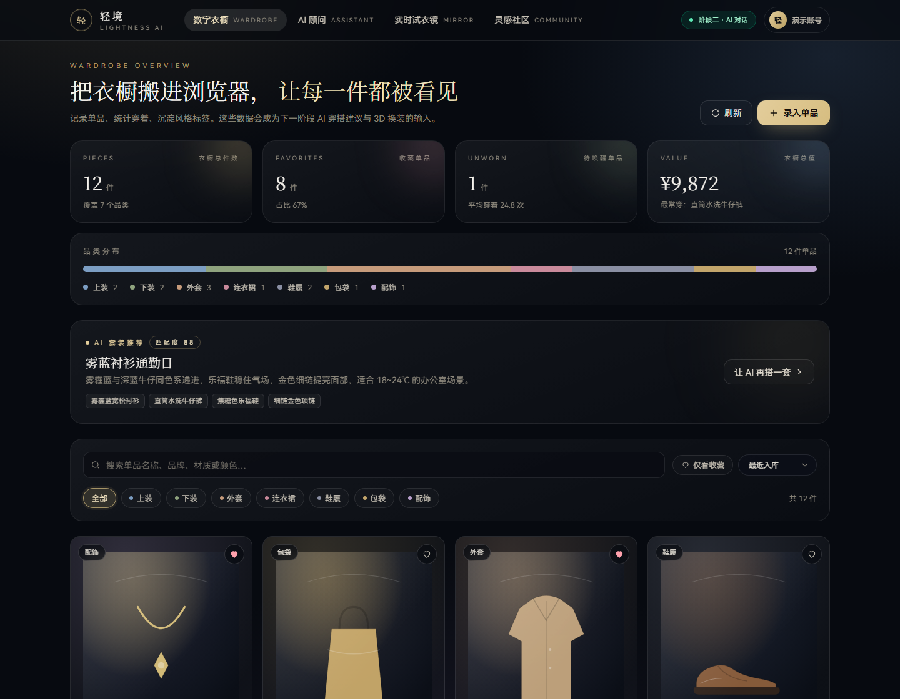
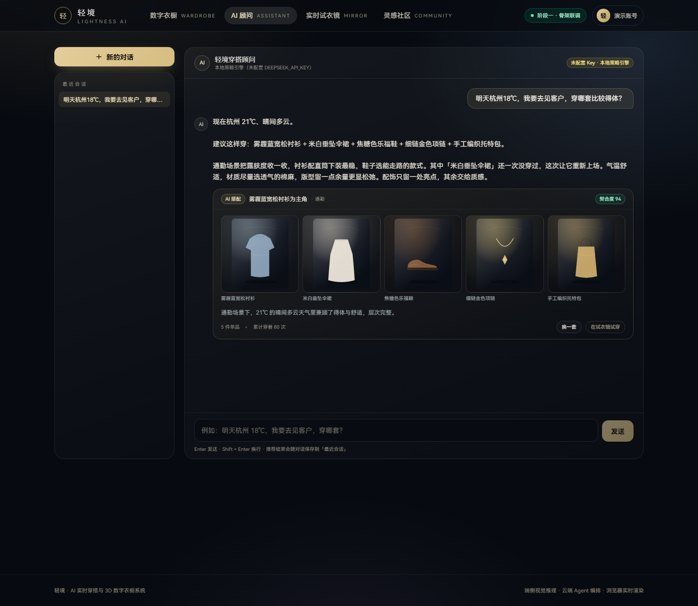
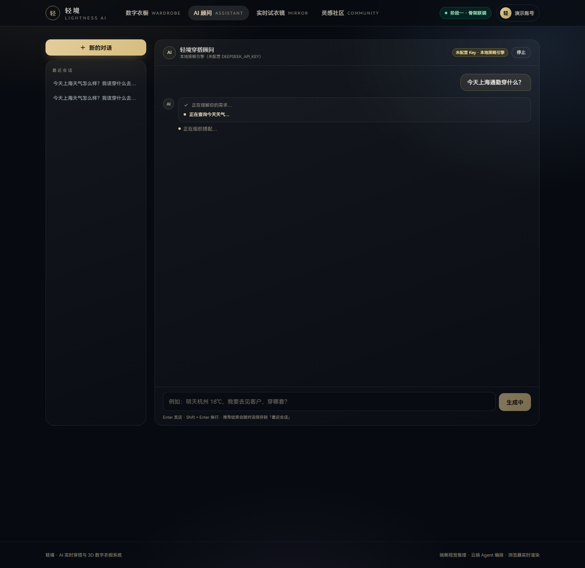
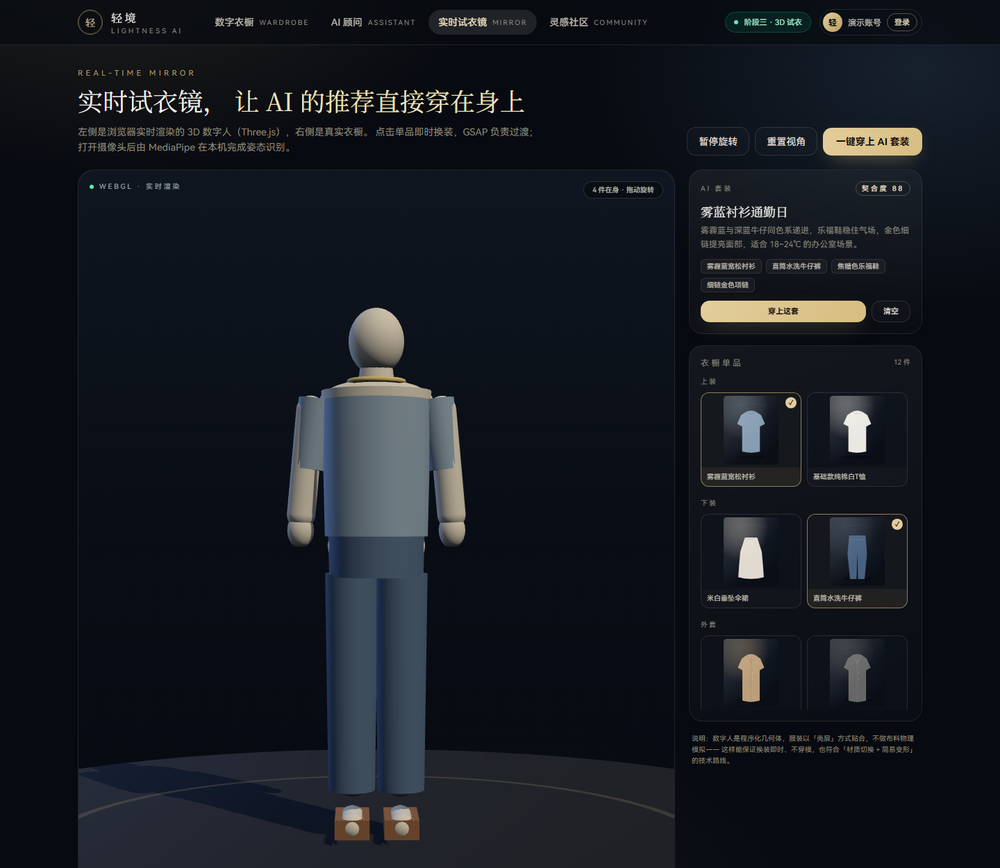
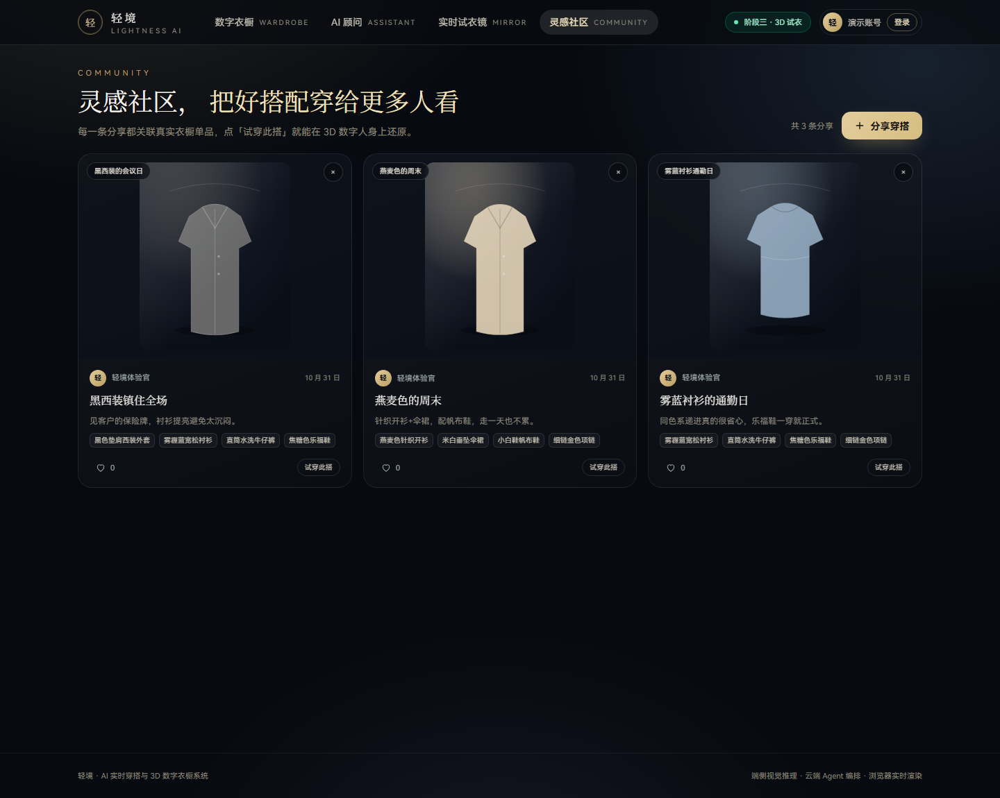

# 轻境 · AI 实时穿搭与 3D 数字衣橱系统

> 赛道：官方方向 6 —— AI 健康与生活服务（生活服务场景）
>
> **当前进度**
> - ✅ 阶段一 · 建库搭架：9 张表、衣橱 CRUD、统计看板、前端工作台
> - ✅ 阶段二 · 接入大模型：SSE 流式对话、Function Calling、轻量 RAG、结构化推荐、会话持久化
> - ✅ 阶段三 · 视觉进阶：Three.js 程序化数字人、GSAP 换装过渡、MediaPipe 端侧姿态识别、JWT 登录
> - ✅ 阶段四 · 融合冲刺：社区发帖/点赞、AI 推荐 → 3D 试衣联动、分享卡片导出、体验打磨

---

## 1. 项目定位

| 维度 | 说明 |
| --- | --- |
| 痛点 | 网购退货率高（试错成本）、日常穿搭决策困难、衣橱利用率无法量化 |
| 形态 | 「实时试衣镜」+「3D 数字衣橱」双模式，配 AI 穿搭顾问与灵感社区 |
| 差异化 | 端云协同：浏览器端 Vision AI 负责感知，Spring Boot 负责 Agent 编排与决策 |
| 阶段二核心 | 让 AI 基于**真实衣橱数据 + 实时天气 + 穿搭知识**给出可直接穿的搭配，而不是模板文案 |

---

## 2. 界面预览（实拍）

| 数字衣橱 | AI 穿搭顾问 |
| --- | --- |
|  |  |

| AI 思考过程（流式） | 实时试衣镜（3D） |
| --- | --- |
|  |  |



---

## 3. 技术栈

**前端**：Vue 3.5 + Vite 6 + TypeScript（strict）+ Pinia + Vue Router + Tailwind CSS 4 + Axios
3D 与视觉：Three.js（程序化数字人 + 实时渲染）、GSAP（换装过渡）、MediaPipe Tasks Vision（端侧姿态）
流式对话用 `fetch + ReadableStream` 自行解析 SSE（EventSource 只支持 GET，承载不了长中文消息体）。

**后端**：Spring Boot 3.5 + MyBatis-Plus 3.5 + MySQL 8
AI 部分只用 JDK 自带 `java.net.http.HttpClient` 做流式 HTTP，没有引入额外的 SDK；
SSE 生成任务跑在**虚拟线程**上，阻塞式模型调用不会占满 Tomcat 线程池。

**数据库**：utf8mb4 / InnoDB，9 张表：`user`、`clothing`、`outfit`、`wear_log`、`post`、`post_like`、`comment`、`chat_session`、`chat_message`

---

## 4. AI 与 3D 管线

### 4.1 云端 Agent 编排（阶段二）

```
用户提问
  │
  ├─ RAG 检索：中文二元组 + 标签命中 → Top-3 穿搭知识片段
  ├─ 上下文拼装：人设规则 + 用户档案 + 衣橱概况 + 知识片段
  │
  ▼
LLM（DeepSeek / 任意 OpenAI 兼容服务，stream=true）
  │  delta 文本 → SSE「delta」事件（前端打字机）
  │  tool_calls → 执行工具 → 结果回填 → 继续生成（最多 3 轮）
  │
  ├─ get_weather(city)      → Open-Meteo 实时天气，失败回退季节气候值
  ├─ search_wardrobe(...)   → 真实单品，按穿着次数升序（优先唤醒久未穿的单品）
  ├─ wardrobe_stats()       → 件数 / 收藏 / 未穿 / 总值 / 品类分布
  └─ recommend_outfit(...)  → 结构化推荐：单品 ID + 契合度 + 理由
  │
  ▼
SSE「recommendation」→ 前端推荐卡片（缩略图、契合度、换一套）
  └─ 落库 chat_message（正文 + 工具轨迹 + 推荐 JSON）
```

**没有 API Key 也能演示**：`OfflineReplyClient` 是本地策略引擎，但走的是**同一条 Agent 管线**——
同样先调 `get_weather`、`search_wardrobe`，再流式输出中文文案并调用 `recommend_outfit`。
两条通道可一键切换，方便对比「真实大模型 vs 规则引擎」的输出差异。

### 4.2 3D 试衣镜（阶段三）

**数字人是程序化生成的，不依赖任何外部 GLB 资源**：躯干 / 四肢 / 头部由 Capsule、Sphere、Cylinder 组合，
服装是包裹在身体外 2~4mm 的「壳层」几何体（上装、下装、外套、连衣裙、鞋履、包袋、配饰各一套 λ 生成器）。

- **换装**：`MirrorScene.setOutfit(items)` → 清空旧壳层 → 按分类重建几何 + 材质 → GSAP `back.out` 弹入
- **交互**：指针拖拽旋转、滚轮缩放、自动旋转开关、一键重置视角
- **AI 联动**：`一键穿上 AI 套装` 把后端 `/api/outfit` 的单品 ID 解析成场景里的衣服
- **为什么不做布料物理**：模拟容易穿模且吃性能；「材质切换 + 壳层几何」能保证换装即时、形体稳定，
  与阶段四要接的 2D 网格形变（TPS）方案兼容

### 4.3 端侧姿态识别（MediaPipe）

- `@mediapipe/tasks-vision` + 本地 `wasm` 运行时 + `pose_landmarker_lite.task`（约 5.8MB），全部随应用本地托管，
  不依赖 CDN（`npm run fetch:assets` 一次性拉取，文件不进版本库）
- `runningMode: VIDEO`，逐帧 `detectForVideo`，在 2D overlay canvas 上绘制 33 点骨架（金色连线，镜像坐标）
- 摄像头权限被拒 / 模型加载失败时只降级提示，3D 试衣照常可用
- 视频帧**不出浏览器**，只有「该穿什么」的决策请求会到服务端

### 4.4 登录与鉴权（JWT）

- `POST /api/auth/login | register` 返回 `token`（HS256，7 天）、过期时间与用户资料
- `JwtAuthFilter` 解析 `Authorization: Bearer`，写入 `UserContext`；没有 token 时继续兼容 `X-User-Id`（演示态）
- 密码使用 BCrypt（`spring-security-crypto`，未启用整套 Spring Security，避免默认过滤器链干扰接口）
- 前端 `stores/auth.ts` 持久化 token，Axios 与 SSE 请求自动带 `Authorization`；页面右上角可登录/退出

### 4.5 社区与联动（阶段四）

- **社区**：`community/posts` 分页信息流、发帖、点赞（`post_like` 唯一键保证一人一赞）、删除（仅本人）
- **发帖可选关联套装**：后端按套装解析出封面与单品名，前端不用再补请求
- **AI → 3D 联动**：推荐卡片的「在试衣镜试穿」把单品 ID 写进路由（`/mirror?ids=2,3,9,12`），
  试衣镜读取后直接换装；社区卡片的「试穿此搭」复用同一条链路
- **分享卡片**：`utils/shareCard.ts` 用 Canvas 2D 绘制 1080×1440 卡片（标题 / 契合度 / 单品缩略图 / 推荐理由），
  直接导出 PNG，可发到社区之外
- **发布入口**：AI 回答里的「分享到社区」把标题、理由、单品图带进发布弹窗，避免重复填写

---

## 5. 目录结构

```
qingjing/
├─ backend/
│  ├─ src/main/java/com/qingjing/
│  │  ├─ ai/                     # Agent 编排、模型通道、RAG
│  │  │  ├─ LlmClient.java           # 流式通道抽象（文本增量 + 工具调用）
│  │  │  ├─ OpenAiCompatibleClient   # DeepSeek 等 OpenAI 兼容服务的 SSE 解析
│  │  │  ├─ OfflineReplyClient       # 无 Key 时的本地策略引擎
│  │  │  ├─ OutfitAgent              # 提示词拼装 + 工具循环
│  │  │  ├─ OutfitKnowledge          # 轻量 RAG（二元组检索）
│  │  │  └─ tool/                    # 四个工具 + 注册表
│  │  ├─ auth/                   # JwtService、JwtAuthFilter、AuthController
│  │  ├─ controller/            # clothing / outfit / meta / AiChat / Community / Auth
│  │  ├─ service/               # ClothingService / OutfitService / ChatService / CommunityService
│  │  ├─ config/                # 分页、用户上下文、密码编码器、AI 装配（虚拟线程执行器）
│  │  ├─ common/ dto/ entity/ mapper/ vo/
│  │  └─ QingjingApplication.java
│  └─ src/main/resources/
│     ├─ application.yml
│     └─ ai/outfit-knowledge.json    # 12 条穿搭知识片段
├─ frontend/
│  ├─ src/api/                  # http.ts（Axios）/ ai.ts（SSE 解析）/ auth.ts
│  ├─ src/stores/               # wardrobe.ts / assistant.ts / auth.ts
│  ├─ src/mirror/               # MirrorScene（Three.js 场景）/ usePoseTracker（MediaPipe）
│  ├─ src/components/           # 衣橱组件 + ai/（思考轨迹、推荐卡片）+ community/（帖子、发布）+ LoginDialog
│  ├─ src/utils/shareCard.ts    # Canvas 分享卡片导出
│  ├─ src/views/                # WardrobeView / AssistantView / MirrorView / CommunityView
│  ├─ scripts/fetch-assets.mjs  # 拉取 MediaPipe 模型与 wasm
│  └─ public/clothing/*.svg     # 12 张演示单品插画
├─ db/schema.sql, db/seed.sql
└─ README.md
```

---

## 6. 快速启动

### 6.1 数据库

```bash
# 工作区内独立实例（端口 3307），避免与系统 MySQL 服务冲突
mysqld --no-defaults --initialize-insecure \
       --basedir="<mysql 安装目录>" --datadir="D:/.../qingjing/.mysql/data"
mysqld --no-defaults --basedir="<mysql 安装目录>" \
       --datadir="D:/.../qingjing/.mysql/data" --port=3307 --bind-address=127.0.0.1

mysql -h127.0.0.1 -P3307 -uroot -e "source db/schema.sql"
mysql -h127.0.0.1 -P3307 -uroot -e "source db/seed.sql"
```

### 6.2 后端（8080）

```bash
cd backend
# 可选：接入真实大模型（不配置则使用本地策略引擎）
export DEEPSEEK_API_KEY=sk-xxxx
mvn spring-boot:run
```

| 环境变量 | 默认值 | 说明 |
| --- | --- | --- |
| `DEEPSEEK_API_KEY` | 空 | 配置后自动切换到真实模型流式输出 |
| `DEEPSEEK_BASE_URL` | `https://api.deepseek.com` | 任意 OpenAI 兼容服务（通义千问兼容模式、Kimi 等） |
| `DEEPSEEK_MODEL` | `deepseek-chat` | 模型名 |

### 6.3 前端（5173）

```bash
cd frontend
npm install
npm run fetch:assets   # 首次：拉取 MediaPipe 模型与 wasm（约 27MB，不进版本库）
npm run dev            # /api 已代理到 8080
npm run build          # vue-tsc 严格模式 + 生产构建
```

演示账号 `demo / 123456`（密码为 BCrypt，可复用于后续登录接口）。

---

## 7. SSE 事件协议

`POST /api/ai/chat/stream`，`Content-Type: text/event-stream`

| 事件 | 负载 | 用途 |
| --- | --- | --- |
| `meta` | `{sessionId, provider, tools, knowledgeChunks}` | 会话建立、当前通道信息 |
| `status` | `{phase, text}` | 思考过程：理解需求 / 查天气 / 翻衣橱 |
| `delta` | `{text}` | 正文增量，前端逐字追加 |
| `recommendation` | `{recommendation:{name,occasion,score,reason,items[]}}` | 结构化搭配，直接驱动卡片 |
| `done` | `{sessionId, messageId, tools}` | 结束，附落库消息 ID 与工具轨迹 |
| `error` | `{message}` | 友好错误（含「可清空 Key 用本地引擎」提示） |

客户端中途断开时，已经生成的内容仍会落库并标注「本次生成被中断」，历史会话不会只剩半句问话。

---

## 8. API 一览

**业务**

| 方法 | 路径 | 说明 |
| --- | --- | --- |
| GET | `/api/health` | 服务 + 数据库健康检查 |
| GET | `/api/meta/categories` | 分类字典 |
| GET | `/api/clothing` | 分页检索：`category`、`keyword`、`favorite`、`season`、`sort`、`page`、`size` |
| GET | `/api/clothing/stats` | 衣橱看板数据 |
| POST/PUT/DELETE | `/api/clothing[/{id}]` | 单品增删改（逻辑删除） |
| PATCH | `/api/clothing/{id}/favorite` | 收藏切换 |
| POST | `/api/clothing/{id}/wear` | 记一次穿着 |
| GET | `/api/outfit` | 套装列表 |

**AI 与鉴权**

| 方法 | 路径 | 说明 |
| --- | --- | --- |
| POST | `/api/auth/login` | 登录，返回 JWT + 用户资料 |
| POST | `/api/auth/register` | 注册并直接登录 |
| GET | `/api/auth/me` | 当前用户资料（需 token） |
| POST | `/api/ai/chat/stream` | 流式对话（SSE） |
| GET | `/api/community/posts` | 社区信息流（作者 / 单品 / 点赞状态） |
| POST | `/api/community/posts` | 发布分享（可关联套装） |
| POST | `/api/community/posts/{id}/like` | 点赞 / 取消点赞 |
| DELETE | `/api/community/posts/{id}` | 删除自己的帖子 |
| GET | `/api/ai/status` | 当前通道、工具清单、知识库规模 |
| GET | `/api/ai/sessions` | 最近 20 个会话 |
| GET | `/api/ai/sessions/{id}/messages` | 会话历史（含推荐 JSON 回放） |
| DELETE | `/api/ai/sessions/{id}` | 删除会话 |

统一响应 `{code,message,data}`；错误码 `40000` 参数、`40400` 不存在、`50000` 服务异常。
身份：阶段一、二由请求头 `X-User-Id` 传递（缺省演示账号 1），阶段三替换为 JWT 时 Service 层无需改动。

---

## 9. 工程决策记录

1. **不引第三方大模型 SDK**：JDK `HttpClient` 直接解析 OpenAI 兼容 SSE，依赖少、可控，换服务商只改 base-url。
2. **SSE 用虚拟线程承载**：几十路并发对话也不会占满 Tomcat 工作线程；工具里的阻塞 IO 同样安全。
3. **结构化输出走工具调用**：让模型调 `recommend_outfit`，而不是在自然语言里塞 JSON——前端拿到的一定是合法的单品 ID 数组。
4. **RAG 先用关键词检索**：中文二元组 + 标签命中，零依赖、可解释；后续换 embedding 只需替换 `OutfitKnowledge.search()`。
5. **无 Key 不阻塞演示**：同一管线的本地策略引擎，让评委在没有密钥的环境也能完整体验。
6. **JSON 列用字符串承载**：`season` / `style_tags` / `item_ids` 由 `JsonUtils` 统一转换，脏数据降级为空集合，不拖垮列表接口。
7. **不用 Lombok**：JDK 25 + 注解处理器存在版本风险，手写访问器换构建稳定。

---

## 10. 阶段路线图

- [x] **阶段一 · 建库搭架**：库表、衣橱 CRUD、统计看板、前端工作台、联调
- [x] **阶段二 · 接入大模型**：SSE 流式、Function Calling（天气/衣橱/统计/推荐）、RAG、会话持久化、推荐卡片
- [x] **阶段三 · 视觉进阶**：Three.js 程序化数字人、GSAP 换装过渡、MediaPipe 端侧姿态、JWT 登录
- [x] **阶段四 · 融合冲刺**：社区信息流 / 发帖 / 点赞、AI 推荐 → 3D 试衣联动、Canvas 分享卡片、体验打磨

---

## 11. 已完成验证

| 验证项 | 结果 |
| --- | --- |
| `mvn package`（JDK 25 + Spring Boot 3.5.16） | 通过，jar 独立启动 |
| 衣橱 CRUD / 统计 / 收藏 / 记穿着 | 全链路通过，逻辑删除生效 |
| 参数校验、404、错误 Content-Type | 统一错误结构，无 500 |
| `POST /api/ai/chat/stream` | meta → 4×status → 34×delta → recommendation → done |
| 工具调用 | `get_weather`（Open-Meteo 实时）、`search_wardrobe`、`recommend_outfit` 均命中 |
| 持久化 | 会话 + 消息 + 推荐 JSON 落库，`?session=N` 可回放 |
| 3D 换装 | 12 件单品映射到 7 类壳层，点击即时替换 + GSAP 弹入，截图见 `mirror.png` |
| MediaPipe | 本地 wasm + 5.8MB 姿态模型加载正常；摄像头不可用自动降级不影响试衣 |
| JWT | `login → Bearer → /auth/me`、衣橱接口按 token 识别用户 |
| 社区接口 | 发帖（自动解析套装封面与单品）→ 点赞 / 取消（`post_like` 唯一键）→ 删除（仅本人） |
| 联动 | `/mirror?ids=5,2,3,9` 打开即还原 4 件单品的整套穿着 |
| 分享卡片 | Canvas 1080×1440 导出 PNG，与 AI 推荐 / 社区共用同一套单品数据 |
| 前端 `npm run build` | 通过；MirrorView 18.2 KB，three 单独分包 530 KB（gzip 132 KB），MediaPipe 动态加载 |
| 页面实拍 | `docs/screenshots/` 五张 |

> 开发提示：Vite 监听已忽略 `*.tmpdir/`（编辑器原子写入的临时目录会导致 EBUSY）；若仍异常，删除 `node_modules/.vite` 重启。